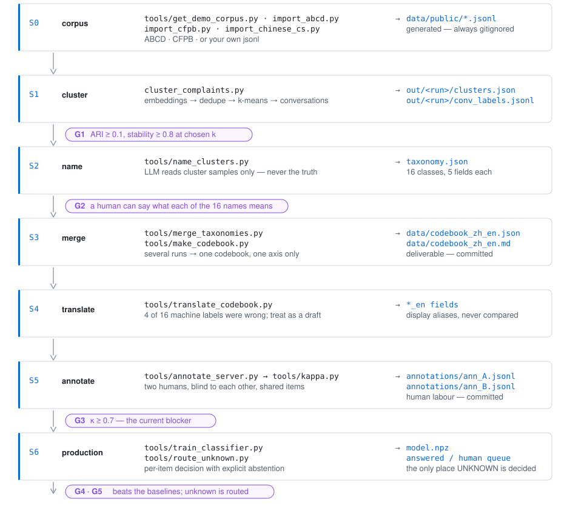

# The pipeline, end to end

`README.md` shows how to run things and `docs/DESIGN.md` explains what happens *inside*
the clustering step. Neither answers the question this document answers: **what is the
whole chain, in what order, and what does each stage prove before the next one is
allowed to start.**

Every stage below has an input, an output, a tool, and a number that tells you whether it
worked. The numbers are measured on this machine, not projected.

Contents: [Why this is shaped this way](#why-this-is-shaped-this-way) ·
[Glossary](#glossary) · [The stages](#the-stages) ·
[Three numbers, three questions](#three-numbers-three-questions) ·
[What is source and what is generated](#what-is-source-and-what-is-generated) ·
[Gates](#gates-and-where-we-are) · [Where to read more](#where-to-read-more)

---

## Why this is shaped this way

The naive approach — hand an LLM a million complaints and ask for the categories — fails
on three counts: it is not idempotent (the same corpus yields different categories on
different days), it cannot be incrementally updated when a new complaint type appears,
and at scale it costs two orders of magnitude more than clustering (roughly $7,500 versus
$8 per million items once embeddings are cached).

So the work is split by what each component is actually good at:

| Component | Owns | Because |
|---|---|---|
| embeddings + k-means | **grouping** the corpus | deterministic given a seed, cheap, incremental (`--apply-model`), no label needed up front |
| LLM | **naming and defining** what was grouped | 10–30 calls over *samples*, not over the corpus; it never decides membership |
| humans | **validating** that the definitions are executable | the only way to tell "the classifier is bad" from "the definitions are vague" |
| supervised model | **production routing** | fast, calibrated confidence, and the only place `UNKNOWN` can be decided per item |

The LLM never sees the clustering labels when writing definitions, and the annotators
never see the ground truth. Both rules exist for the same reason: if a definition is
written by looking at the answer, the codebook can no longer be tested against new data.

## Glossary

**Cluster** — a group of sentences that a k-means run put together. A cluster is a
*position in vector space*, not a meaning. It is identified by an integer that changes on
every run, which is exactly why nothing downstream is allowed to use it as a label.

**Taxonomy / codebook** — the answer to "what does the complaint space look like", as a
list of named classes, each with five fields:

| Field | Answers |
|---|---|
| `label` | what to call it (canonical, always Chinese in this project) |
| `definition` | when it applies |
| `includes` | which situations belong in it |
| `boundary` | how it differs from the class it is most often confused with |
| `counterexample` | what looks like it but is not |

`label_en`, `definition_en` … are display aliases for the annotation interface; the
canonical comparison is always on `label`, so a translation can never split one class in
two. A codebook also needs **precedence rules** — when two classes both fit a
conversation, which one wins. That field is currently empty, and filling it is the main
open task (see [Gates](#gates-and-where-we-are)).

**`primary`** — the single document-level label for a whole conversation. The pipeline
emits both shapes: `labels` (sentence-level, multi-label, with counts) and `primary`
(conversation-level, single label, nearest centroid over the whole dialogue). Classification
and all reported accuracy numbers use `primary`; `labels` is what the clustering produces
and what makes "this conversation raises two complaints" visible.

**Procedural sentence** — authentic customer-service traffic that is not a complaint: a
name, an account ID, "yes", "thanks, that's all". These were 38% of the Chinese sentence
set (1,201 of 3,148) and they formed four clusters of their own. They are the single
biggest contaminant of a complaint taxonomy and they cannot be removed by
document-frequency filters, because names and account numbers are unique by construction.

**`UNKNOWN`** — not a class. It is the abstention option for an annotator and the routing
decision for production: "this item is outside the taxonomy, send it to a human".

**Cohen's kappa** — agreement between two annotators, corrected for what they would
achieve by guessing:

$$
\kappa = \frac{p_{\text{observed}} - p_{\text{expected}}}{1 - p_{\text{expected}}}
$$

$p_{\text{expected}}$ is the share of agreement two annotators would reach by each
labelling at random with their own label frequencies. Raw agreement is therefore useless
on its own: two annotators who both pick the biggest class 70% of the time agree
$0.7^2 = 0.49$ of the time by luck alone. $\kappa = 1$ is perfect, $0$ is chance, and
$\kappa < 0$ is worse than chance.

**It measures the codebook, not the annotators.** A low kappa means the definitions admit
more than one reading; the fix is a sharper definition, not a more careful person. Removing
easy items raises kappa without telling you anything — which is why `tools/kappa.py`
reports the disagreement pairs rather than only the score.

**ARI (adjusted Rand index)** — agreement between two *partitions* of the same items,
corrected for chance. Used to compare a clustering against a known label set. 0 is
chance, 1 is identical. Rough ladder: below 0.1 is near-random, 0.1–0.3 weak but real,
0.3–0.5 moderate, above 0.5 good.

## The stages

Each arrow is a dependency, not a suggestion: a stage reads what the previous one wrote, and
starts because the gate on that file passed, not because the file exists. The purple chips are
the gates defined in [Gates and where we are](#gates-and-where-we-are); S3 and S4 carry no
numbered gate — their checks are in the *Verified by* column below.

| # | Stage | In → Out | Tool | Verified by |
|---|---|---|---|---|
| S0 | corpus | dataset → `data/public/*.jsonl` | `tools/get_demo_corpus.py`, `import_abcd.py`, `import_cfpb.py`, `import_chinese_cs.py` | the file rebuilds from one command; nothing generated is in git |
| S1 | cluster | conversations → sentence labels + centroids | `cluster_complaints.py` | **ARI** vs a labelled slice, plus `--kmeans-algo bisect` run-to-run stability |
| S2 | name | cluster samples → classes with definitions | `tools/name_clusters.py` | `--check` validates every entry and exits non-zero if any field is missing or empty (current codebook: 16/16 pass) |
| S3 | merge | several taxonomies → one codebook | `tools/merge_taxonomies.py`, `tools/make_codebook.py` | every class belongs to the *same axis*; near-duplicates merged by definition similarity |
| S4 | translate | codebook → codebook with `*_en` | `tools/translate_codebook.py` | 4 of 16 machine labels were wrong and were corrected by hand — treat output as a draft |
| S5 | annotate | codebook + items → two jsonl files | `tools/annotate_server.py`, `tools/annotation_page.py` | **Cohen's kappa** on 100–200 shared items, plus the disagreement pairs |
| S6 | production | labels → classifier → per-item decision | `tools/train_classifier.py`, `tools/route_unknown.py` | **accuracy on held-out items**, and the coverage/accuracy trade-off curve for routing |

Inside S1 the sentence pipeline has sixteen sub-stages, each of which exists because
something failed without it (conjunction splitting, boilerplate filtering, near-duplicate
dedupe, orphan rescue…). They are documented one by one in
[`docs/DESIGN.md` §3](DESIGN.md). For the rest of this document, S1 is a black box that
turns dialogues into clusters plus a centroid matrix.

## Three numbers, three questions

The most common mistake in a project like this is quoting one number for three different
claims. They answer different questions and are not comparable:

| Number | Measured by | Question it answers | Current value | What a bad value means |
|---|---|---|---|---|
| **ARI** | `tools/eval_against_labels.py` | does the *unsupervised* partition recover the intended structure? | 0.225 (zh, k=10) · 0.301 (en, k=10) · ceiling 0.519 | the representation or the class boundaries are wrong — not that k-means is broken |
| **kappa** | `tools/kappa.py` | can two humans apply the *definitions* consistently? | **not yet measured** (tooling built, no double annotation run) | the codebook is unreadable, regardless of how good the clustering was |
| **accuracy** | `tools/train_classifier.py` | how well does the *decision layer* work on labelled items? | 0.810 (macro-F1 0.522, n=268) | too few labels, or classes that the text does not contain |

Two rules that follow, and are easy to violate:

- **Never quote purity.** Purity rises monotonically with k (0.414 → 0.550 as k went
  10 → 40) while ARI stayed flat (0.225 → 0.245). A metric that improves when you
  fragment the answer is not a quality metric.
- **Never quote accuracy from labels derived from the clustering.** The 0.810 above was
  measured on labels produced by a model that had read the cluster samples, so it partly
  measures self-consistency. The deployable number has to come from human labels.

## What is source and what is generated

The repository's git policy follows from one rule: **anything that can be rebuilt by one
command, or that carries corpus text, does not get committed.**

| Path | Kind | In git? | Why |
|---|---|---|---|
| `data/seeds*.jsonl` | source | yes | hand-written seed sets; not derivable |
| `data/abcd_flow_coarse.json` | source | yes | the flow → 4-group mapping used by the lever experiments |
| `data/codebook_zh_en.json` / `.md` | **deliverable** | yes | the taxonomy is the project's output; readers should not need to run an LLM to see it |
| `data/public/` | generated corpus | no | one command rebuilds it, and it is megabytes of customer text |
| `out/` | run artefacts | no | centroids, clusters, models — reproducible from a seed |
| `annotation/` | generated packet | no | items, blank sheets, HTML; rebuilt from the codebook |
| `annotations/` | **human labour** | yes | filled-in answers cannot be rebuilt, and they are the evidence behind every kappa claim |

The split that took two iterations to get right: the *packet* is generated and ignored,
but the *answers* are not. They live in a separate directory (`annotations/`, plural) for
exactly that reason.

## Gates and where we are

Each stage has a gate. Do not start the next stage because the previous one produced
output; start it because the gate passed.

| Gate | Threshold | Status |
|---|---|---|
| G1 clustering is better than chance and stable | ARI ≥ 0.1, stability ≥ 0.8 at chosen k | **passed** — 0.225 / 0.863 at k=10 |
| G2 clusters are nameable | a human reads 16 names and can say what each means | **passed** after merging two runs into one codebook (16 classes, 2,125 conversations) |
| G3 the codebook is executable | **kappa ≥ 0.7** on 100–200 items between two blind annotators | **open** — this is the current blocker |
| G4 the classifier beats the naive baselines | accuracy > nearest centroid, macro-F1 reported honestly | **passed mechanically** (0.810 vs 0.754 vs 0.220 majority), but on self-derived labels |
| G5 unknown input is routed, not guessed | coverage/accuracy curve measured on a simulated unknown class | **partly** — `distance` scoring at threshold 0.30 routed 79% of a held-out class to a human; the smallest class had only 2 items, so the curve is directional |

Why G3 blocks G4 and G5: every accuracy number downstream is only as trustworthy as the
labels it was measured on. If two humans cannot agree on the definitions, a classifier's
0.81 might be reproducing one model's reading of an ambiguous rule.

The most likely outcome of the first real kappa run is **0.5–0.65**, not 0.8. That is not
failure — the rule is that below 0.6 the definitions are not doing their job, and the
*disagreement pairs* tell you which two classes need a precedence rule. Expect two or
three rounds of "add a boundary sentence, re-measure".

## Where to read more

| Document | Contains |
|---|---|
| `README.md` | how to run it, every flag, all measured tables |
| `docs/DESIGN.md` | the sixteen sub-stages inside S1, the decision log, the roadmap IDs (R1–R6) |
| `docs/ARCHIVE.md` | experiments whose code was removed once their conclusion stopped changing |
| `annotation/README.md` | generated with each packet: the two-annotator protocol and the export rules |
| `data/codebook_zh_en.md` | the current 16-class codebook, bilingual |
